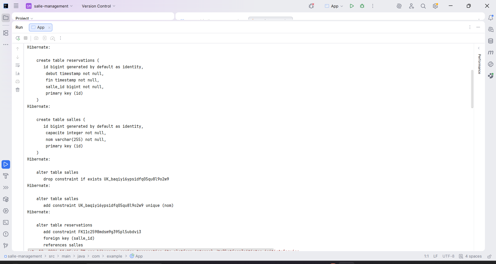
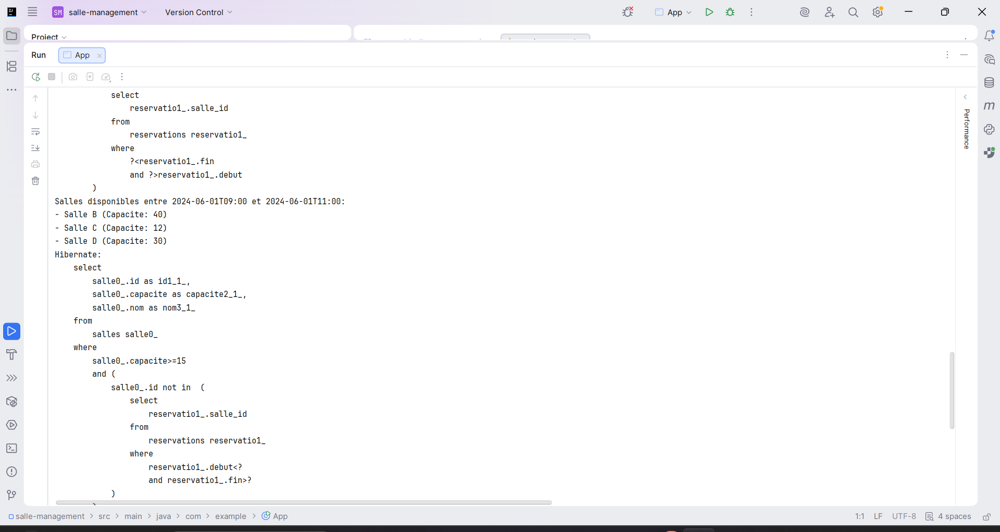
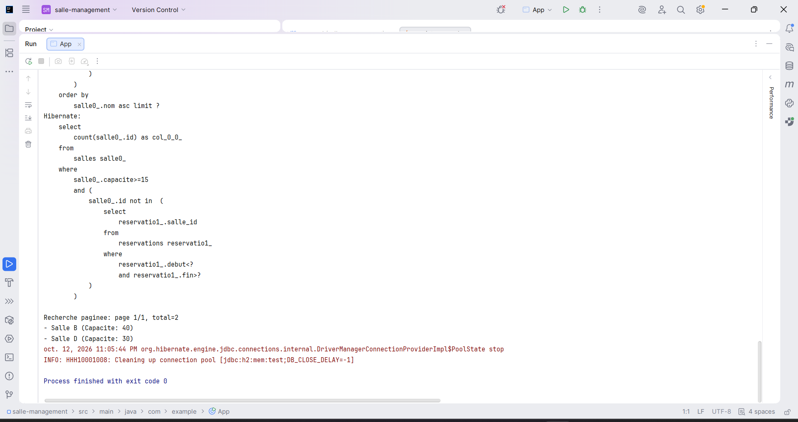

# salle-management

Application Maven JPA/Hibernate permettant de gérer des salles et des réservations avec une base H2 en mémoire.

## Captures d'exécution

### Initialisation de la base de donnees

Cette capture montre le demarrage de l'application avec Hibernate. Les tables `salles` et `reservations` sont creees automatiquement dans la base H2 en memoire, puis les contraintes de relation entre les entites sont appliquees.

### Recherche des salles disponibles

Cette capture montre le resultat de la requete JPQL qui cherche les salles disponibles entre 09:00 et 11:00. La salle deja reservee sur ce creneau est exclue du resultat.

### Recherche multicriteres avec pagination

Cette capture montre l'execution de la recherche dynamique avec Criteria API et pagination. Le resultat affiche uniquement les salles disponibles respectant la capacite minimale demandee.

